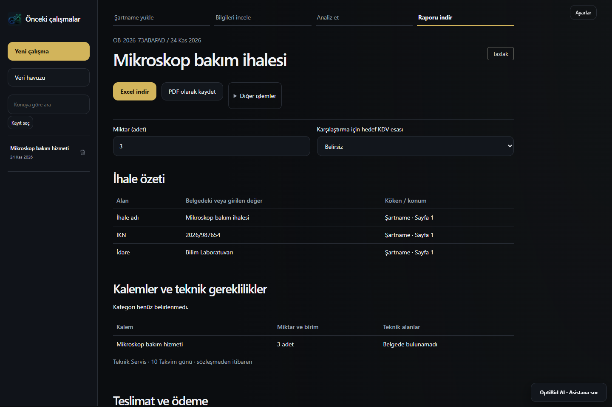
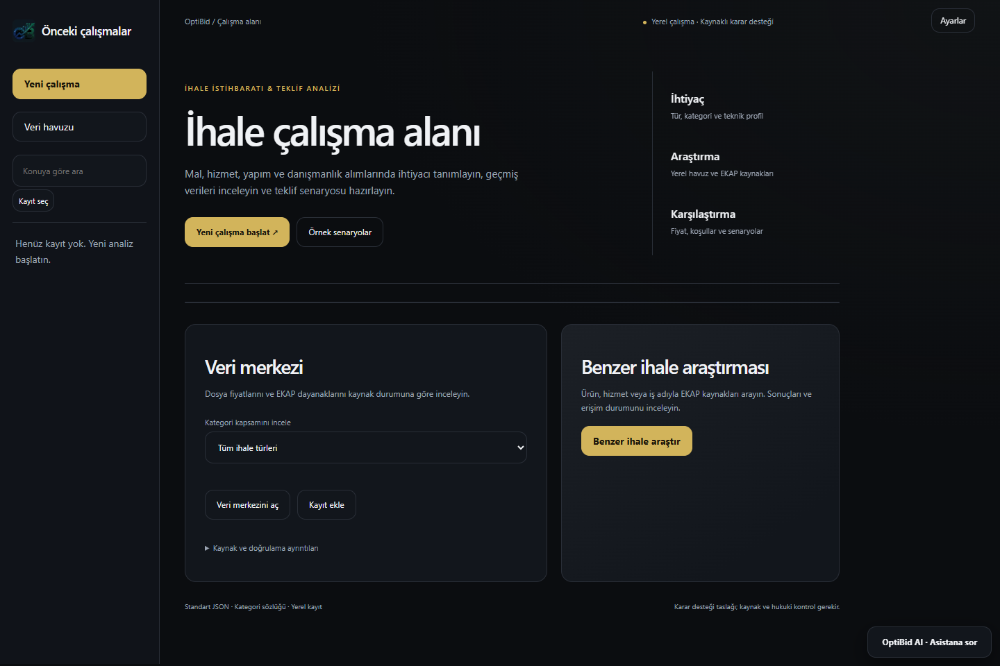
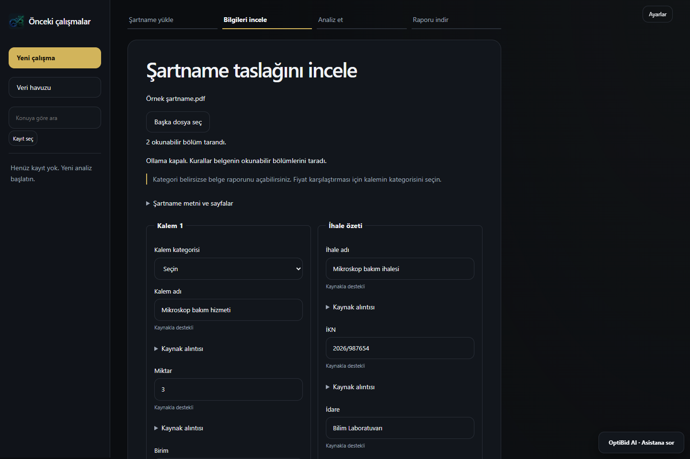
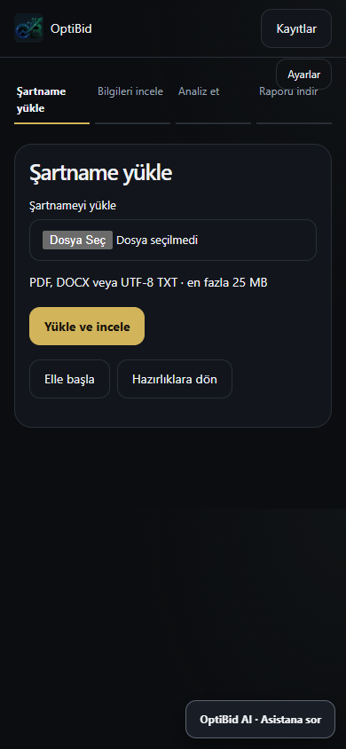
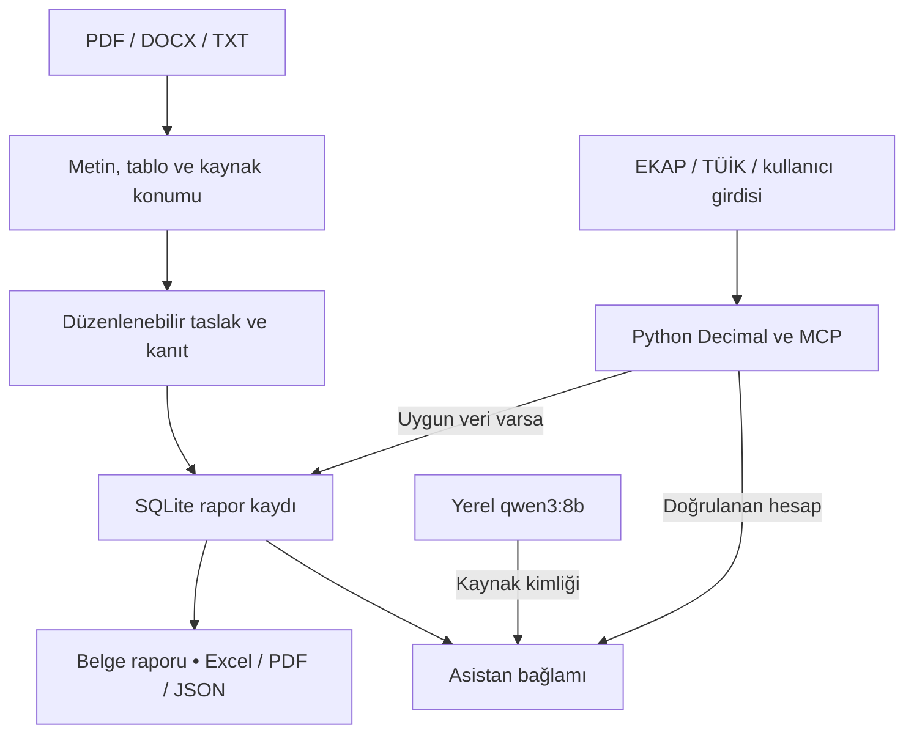

# OptiBid

Kamu ihalelerine teklif hazırlayan ekipler için yerel şartname ve maliyet analizi. OptiBid, yüklenen şartnamedeki kalemleri, miktarları ve yükümlülükleri kaynağıyla gösterir. Kullanıcı belgeyi inceler, gerekli alanları düzenler ve aynı analizden Excel ya da PDF raporu alır.



## Ne yapar?

- Metinli PDF, DOCX ve UTF-8 TXT okur. Kalem, miktar ve birim ilişkisini, kaynak sayfasını veya Word bölümünü korur.
- İhale adı, İKN, idare, teslimat, ödeme, teminat, garanti, ceza ve istenen belgeler için kaynakları gösterir. Kullanıcı düzenlemesini ve önceki dayanağı ayrı tutar.
- Kategori belirsizken belge raporu oluşturur. Uygun veri varsa EKAP sonuçlarını ve TÜİK Yİ-ÜFE ile endekslenmiş fiyatları inceler. Dosyadan aktarılmış beyanlar ayrı görünür.
- Alış fiyatı, gider ve kâr hedefinden **Decimal** ile maliyet, teklif ve marj hesaplar. Hesap MCP aracıyla çalıştırılır ve Python sonucuyla karşılaştırılır. Ollama, uygun kaynak kimliklerini seçmekte kullanılır.
- Sonuçları çalışma revizyonu, belge SHA-256 ve veri sürümüyle saklar. Excel, PDF yazdırma ve JSON aynı rapor kaydını temel alır.

<details>
<summary>Gerçek Chrome ekranları</summary>







Ekranlar sentetik örnek şartnameyle alınmıştır.

</details>

## Kurulum ve demo

Windows’ta doğrulanan sürüm **Python 3.12.14**. Çalışma sunucusu Python standart kütüphanesinde, veriler SQLite’ta, arayüz HTML/CSS/JavaScript’tedir. Ek paketler `requirements.txt` dosyasında listelenir.

1. ZIP’i çıkarın. `OptiBid` klasöründe **Kurulum.bat** dosyasını ilk kurulum için, **Baslat.bat** dosyasını uygulamayı açmak için çalıştırın. Tarayıcı hazır olduğunda `http://127.0.0.1:8818/` açılır.
2. **Yeni çalışma başlat → Yükle ve incele** yoluyla [örnek PDF’yi](tests/fixtures/ornek-sartname.pdf) seçin. Bu sentetik belge 3 adet mikroskop bakım işi ile ikinci sayfada teminat, garanti ve cezayı içerir.
3. İnceleme ekranında alanları ve dayanakları açın. **Analiz et** ile raporu oluşturup **Excel indir** veya **PDF olarak kaydet** seçeneğini kullanın.
4. [A4 TXT örneğini](tests/fixtures/a4_sentetik.txt) ayrı çalışma olarak yükleyin. 1.000 koli × 5 paket, 5.000 paket eder. Rapordaki asistana “KDV hariç alış 95 TL/paket, nakliye 12.000 TL, diğer gider 6.000 TL, finansman 0 TL. Maliyet üzerine %10.” yazın. Çıktı 493.000 TL maliyet, 542.300 TL satış ve 108,46 TL/pakettir.

Ollama isteğe bağlıdır. Yüklüyse `ollama pull qwen3:8b` komutuyla modeli hazırlayın. `/api/saglik`, seçili modeli ve MCP’yi ayrı gösterir. Poppler (`pdftoppm`), Tesseract ve Türkçe dil paketi isteğe bağlı OCR bağımlılıklarıdır. Yerel kullanıcı verileri `%LOCALAPPDATA%\OptiBidIhaleAjani` altında saklanır. Ayrı test ortamı için `OPTIBID_KULLANICI_DIZINI` tanımlanabilir.

## Analiz akışı



[Veri kartı](VERI_KARTI.md) ve [mimari](MIMARI.md). Paylaşım ZIP’i kod, sentetik örnekler ve lisans metni mevcut fontları içerir. Özgün EKAP arşivi, kullanıcı belgeleri, fiyat dosyaları ve SQLite çalışma verileri yerel kurulumda kalır. Bu verileri ayrı ve yetkili bir kaynakla kurma yolları veri kartında açıklanır.

## Testler

```powershell
$env:OPTIBID_LLM = 'off'
python -B -X utf8 -m unittest discover -s tests -p test_ajan_kanit.py -v
python -B -X utf8 -m unittest discover -s tests -p test_belge_rapor.py -v
```

Dağıtımın 19 çevrimdışı testi geçti. Yerel tam veri takımı 101 testte 91 geçti. Başlangıçta da başarısız olan 10 veri testi, özellikle 200 toplam ve 58 kâğıt kaydı gibi eski veri beklentilerini içerir. Chrome testinde iki farklı belge, bozuk/boş/taranmış PDF, alan düzenleme, mobil asistan ve Excel/PDF çıktısı doğrulandı. Chrome’da kullanılan örneklerin fiyatları sentetik maliyet senaryosudur.

## Sınırlamalar

Karmaşık, taranmış veya farklı yerleşimli belgelerde elle inceleme gerekebilir. Bu ortamda Tesseract bulunmadığından taranmış belgeye ait anlaşılır hata yolu sınandı. Bilinmeyen kategori veya KDV, doğrudan emsal sonucu vermeyebilir. İstatistiksel kazanma olasılığı üretilmez. Kural ve kaynak kontrollerine rağmen alan çıkarmada hata mümkündür. İhale uygunluğu ve teklif kararı kullanıcıya aittir.
